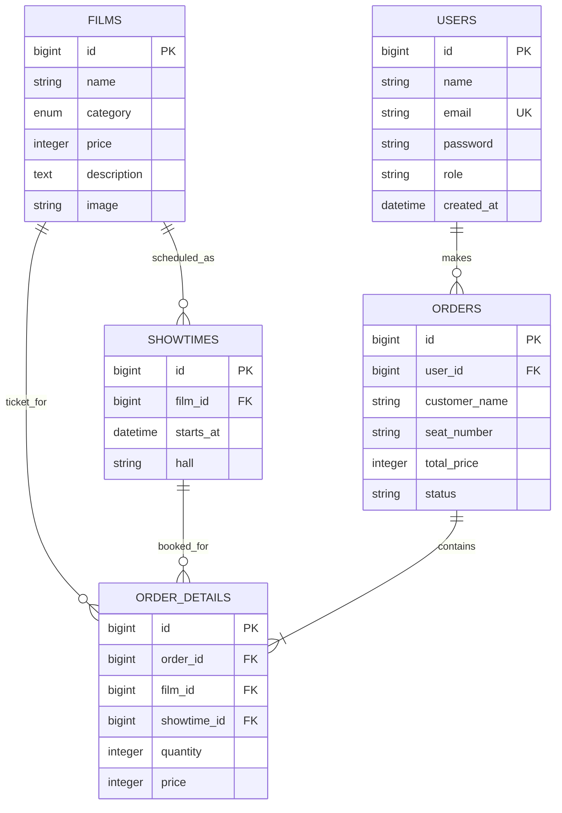

# Entity Relationship Diagram

## Relasi dan aturan

- Satu film memiliki banyak jadwal tayang dan banyak baris detail tiket.
- Satu pesanan memiliki satu atau lebih detail tiket.
- Detail tiket menunjuk film dan, untuk pesanan baru, jadwal tayang tertentu.
- `order_details.price` menyimpan harga satu tiket saat transaksi, sehingga laporan historis tidak berubah ketika harga film diubah.
- `orders.user_id` dapat kosong untuk pesanan lama yang dibuat sebelum akun penonton terhubung; jika akun dihapus, pesanan tetap disimpan dan referensi akun dibuat kosong.
- Peran akun disimpan pada `users.role`: `admin` atau `user`. Pendaftaran publik selalu membuat peran `user`.
